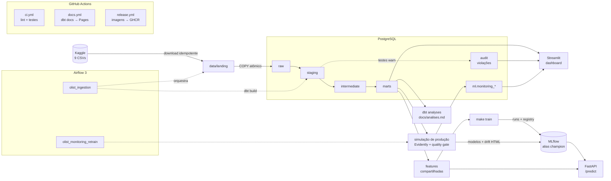

# Olist Logistics Platform

[](https://github.com/mathewsca/olist-logistics-platform/actions/workflows/ci.yml)
[](https://mathewsca.github.io/olist-logistics-platform/)
[](https://github.com/mathewsca/olist-logistics-platform/releases)

[](LICENSE)

Projeto de **ciência de dados *fullstack*** sobre **logística de e-commerce**, construído com o
[Brazilian E-Commerce Public Dataset by Olist](https://www.kaggle.com/datasets/olistbr/brazilian-ecommerce)
(99.441 pedidos de 2016 a 2018). O projeto cobre todo o caminho, da ingestão dos CSVs brutos a um modelo servido
por API, monitorado contra *drift* e retreinado com *quality gate*. Ele responde a uma pergunta de negócio:
**quais entregas vão atrasar, e por quê?**

Tudo roda localmente com `docker compose`, sem nuvem paga.

**Links rápidos:** [dbt docs e linhagem](https://mathewsca.github.io/olist-logistics-platform/) ·
[análises](docs/analises.md) · [modelagem](docs/modelagem.md) · [monitoramento](docs/monitoramento.md) ·
[model card](docs/model_card.md) · [dados](docs/dados.md) · [API e dashboard](docs/deploy.md) ·
[usar como template](docs/template.md)

## O que este projeto demonstra

| Função | Entrega | Onde está |
|---|---|---|
| **Engenharia de dados** | Ingestão idempotente e atômica (Kaggle → Postgres `raw`), DAGs no Airflow 3, dbt em camadas com testes em todos os modelos e anomalias da fonte contadas e documentadas | [`ingestion/`](src/olist_platform/ingestion/), [`dbt/`](dbt/), [`airflow/dags/`](airflow/dags/) |
| **Análise de dados** | 14 análises SQL versionadas (SLA, rotas, receita, sazonalidade, frete, pagamento, avaliações, vendedores), relatório gerado e dashboard Streamlit com 8 páginas | [`dbt/analyses/`](dbt/analyses/), [`docs/analises.md`](docs/analises.md), [`dashboard/`](dashboard/) |
| **Ciência de dados** | Problema definido no momento da compra, controle de vazamento, divisão temporal, baselines, desbalanceamento, calibração e SHAP | [`features/`](src/olist_platform/features/), [`models/`](src/olist_platform/models/), [model card](docs/model_card.md) |
| **ML engineering** | Mesmo módulo de features no treino e na API (paridade testada com dados reais), FastAPI com contrato Pydantic, imagem multi-stage e fallback sem MLflow | [`api/`](src/olist_platform/api/), [`Dockerfile.api`](Dockerfile.api) |
| **MLOps** | MLflow Tracking e Registry, simulação de produção com Evidently, gatilhos de retreino, *quality gate*, CI/CD com GitHub Actions e GHCR | [`monitoring/`](src/olist_platform/monitoring/), [`.github/workflows/`](.github/workflows/) |

## Arquitetura



## Resultados

### Principais achados

Pedidos entregues com data de entrega (96.470), com atraso = entregue depois da data prometida pela Olist. Todos
os números vêm de [`docs/analises.md`](docs/analises.md), gerado por `make analyses` em 2026-11-05.

**Prazo e rotas**

1. **A promessa é conservadora e quase sempre cumprida.** Só 6,8% das entregas atrasam. O prazo prometido médio é
   de 24,4 dias, contra 12,6 dias reais; a folga mediana é de 12,4 dias, e 75,9% das entregas chegam 7 ou mais dias
   antes da data prometida.
2. **O atraso se concentra em picos.** Em quase todos os meses de 2017-01 a 2018-08 a taxa fica entre 1,2% e 7,5%,
   mas sobe para 12,4% em 2017-11 (Black Friday), 14,1% em 2018-02 e 19,0% em 2018-03.
3. **A rota explica mais do que a distância.** O prazo prometido cresce com a distância (16,0 dias abaixo de
   100 km, 33,8 dias acima de 2.000 km), mas a taxa de atraso também sobe, de 4,5% para 12,0%. SP → RJ tem 14,1%
   de atraso em 8.154 entregas, contra 5,3% em SP → MG (7.438 entregas), com distâncias médias parecidas (441 e
   495 km). Por UF do cliente, AL (21,4%), MA (17,4%) e SE (15,2%) lideram, e SP fica em 4,5%.
4. **Categoria e frete diferenciam pouco.** Entre as categorias com mais de 1.000 entregas, a taxa vai de 4,2% a
   8,1%. O atraso cresce com o frete (4,3% abaixo de R$ 10 e 8,6% acima de R$ 50), mas o frete acompanha a distância
   (73 km e 1.061 km em média nessas faixas), então não é um efeito independente.

**Operação e receita**

5. **Nos picos, o atraso alcança a receita.** A parte da receita entregue (itens + frete) que chegou com atraso
   passa de 10% em 2017-11 (12,9%), 2017-12 (10,4%), 2018-02 (15,5%) e 2018-03 (19,8%); nos outros meses de 2017-01
   a 2018-08, fica entre 1,5% e 8,2%.
6. **Compras de sexta esperam mais pelo vendedor.** Elas levam 4,21 dias até a postagem, contra 2,71 nas de
   segunda, e chegam em 13,57 dias, contra 12,00. A taxa de atraso varia pouco entre os dias (6,2% a 7,4%).
7. **O boleto atrasa o começo da entrega.** A aprovação mediana leva 29,1 horas, contra 0,3 hora no cartão de
   crédito; entregas pagas com boleto levam 13,49 dias em média, contra 12,35, e atrasam um pouco mais (7,3% contra
   6,7%).
8. **O frete pesa mais nas rotas longas.** A mediana de frete ÷ valor dos itens vai de 17,2% abaixo de 100 km a
   34,0% acima de 2.000 km.

**Cliente**

9. **Atrasar custa caro na avaliação.** Entregas no prazo têm nota média entre 4,03 e 4,32. Com 1 a 3 dias de
   atraso a média cai para 3,29; com 4 a 7 dias, para 2,10, e 67,7% das notas são 1 ou 2.
10. **A entrega domina os comentários.** 65,5% dos comentários de notas 1–2 citam entrega, prazo ou recebimento, e
    29,7% deles são de pedidos atrasados (2,5% entre os de notas 4–5). Mesmo nos elogios, 49,5% falam da entrega.
11. **Vendedores que atrasam mais têm notas piores.** Entre os vendedores com 30 ou mais entregas, a nota média
    cai de 4,27 (atraso abaixo de 5%) para 3,97 (10% a 20%) e 3,51 (20% ou mais, 13 vendedores).
12. **Um primeiro atraso não muda a recompra de forma detectável.** A recompra em 180 dias é rara nos dois grupos:
    2,46% entre os 3.778 clientes cuja primeira entrega atrasou e 2,86% entre os 52.127 que a receberam no prazo.
    Um teste z de duas proporções sobre essas contagens dá p = 0,15 (IC 95% da diferença: −0,91 a +0,12 p.p.).

### Modelagem preditiva

Dois modelos preveem, **no momento da compra**, se o pedido vai atrasar e em quantos dias vai chegar, só com
informação disponível naquele instante (colunas excluídas por vazamento no [model card](docs/model_card.md)).
Divisão temporal: treino até 2018-03, validação em 2018-04/05 e teste de 2018-06 a 2018-08. O campeão e o limiar
são escolhidos só com a validação; o teste aparece para todos os métodos apenas para mostrar a mudança de regime.
Os números vêm de [`docs/modelagem.md`](docs/modelagem.md), gerado por `make train` em 2026-11-05;
cinco execuções (2026-10-28, três em 2026-10-30 e 2026-11-05) deram os mesmos valores.

**Atraso (`is_late`)**: a taxa de atraso é de 5,5% na validação e de 3,6% no teste, então a PR-AUC de um
classificador aleatório é a própria taxa.

| método | PR-AUC validação | PR-AUC teste | ROC-AUC teste | F1 teste |
|---|--:|--:|--:|--:|
| Classe majoritária (= confiar no prazo da Olist) | 0,055 | 0,036 | 0,500 | 0,000 |
| Regra: mediana da rota − prazo prometido | 0,099 | 0,121 | 0,761 | 0,119 |
| **Regressão logística (classes balanceadas)** (campeão) | 0,153 | 0,072 | 0,662 | 0,109 |
| LightGBM | 0,128 | 0,099 | 0,746 | 0,169 |

**Dias até a entrega (`delivery_days`)**:

| método | MAE validação | MAE teste | RMSE teste |
|---|--:|--:|--:|
| Prazo estimado da Olist | 13,41 | 13,29 | 15,94 |
| Mediana da rota UF → UF | 4,72 | 4,45 | 5,86 |
| Regressão linear (Ridge) | 5,86 | 6,39 | 7,81 |
| **LightGBM** (campeão) | 5,02 | 4,36 | 5,85 |

- **Prever atraso na compra é difícil, e a mudança de regime pesa.** O campeão de validação (regressão logística)
  cai de 0,153 para 0,072 de PR-AUC no teste, abaixo da regra da rota (0,121) e do LightGBM (0,099). O teste é um
  trimestre de atraso baixo, depois do pico de 2018-02/03 que domina o fim do treino. A escolha pela validação foi
  mantida de propósito: trocar o campeão olhando o teste seria selecionar no teste.
- **As probabilidades do campeão não estão calibradas.** Com classes balanceadas, o decil de maior risco prevê
  87,6% e observa 7,8% de atraso. Servem para ordenar pedidos por risco, não como probabilidade.
- **Na regressão, o LightGBM erra 4,36 dias em média no teste**, contra 13,29 dias do prazo estimado da Olist,
  que é uma promessa conservadora e não uma previsão. A vantagem sobre a mediana da rota (4,45) é pequena.
- As features que mais pesam no LightGBM de atraso (SHAP) são o mês da compra, o prazo prometido e a UF do
  cliente.

### Monitoramento e retreino

Os meses de 2018-04 a 2018-08 são reproduzidos como produção, um de cada vez. Cada mês é avaliado pelo campeão que
estava no ar quando ele começou, um mês depois de fechar, quando os rótulos já chegaram. O Evidently mede o
*drift* das features (o relatório de cada mês fica no MLflow), e o retreino dispara por *drift*, queda de lift ou
aumento do MAE. O *quality gate* compara o par que serviu o mês com a receita de retreino ajustada só com o que se
sabia no início dele; o campeão só é trocado se a receita vencer. Números de
[`docs/monitoramento.md`](docs/monitoramento.md), gerado por `make monitor` em 2026-11-05 (mesmos valores da execução de 2026-10-31).

| mês | atraso | lift (validação: 2,25) | sinalizados | MAE (validação: 5,37) | features com *drift* | decisão |
|---|--:|--:|--:|--:|--:|---|
| 2018-04 | 3,4% | 3,75 | 26,4% | 4,85 | 23,5% | mantém |
| 2018-05 | 6,3% | 2,03 | 37,2% | 4,65 | 41,2% | mantém |
| 2018-06 | 0,8% | 4,90 | 29,7% | 4,65 | 35,3% | mantém |
| 2018-07 | 3,1% | 1,89 | 64,8% | 4,24 | 35,3% | mantém |
| 2018-08 | 6,2% | 1,55 | 84,2% | 3,64 | 47,1% | retreino → desafiante rejeitado |

- **O campeão envelhece, e o gatilho de lift pega isso em 2018-08**: 1,55 contra o piso de 1,69 (75% da
  validação). O *drift* sobe para 47,1% das features, perto do gatilho de 50%, sem atingi-lo.
- **O quality gate barrou um retreino que não ajudava.** Ajustada com o que se sabia em 2018-08-01, a receita
  teve PR-AUC de 0,078 no mês, contra 0,092 do campeão, e MAE de 3,59 contra 3,43. Os dois ficaram abaixo da
  regra da rota (0,157).
- **O limiar envelhece mais rápido que o ranking.** Ele sinaliza 26,4% dos pedidos em 2018-04 e 84,2% em 2018-08,
  com taxas de atraso parecidas. Nenhum gatilho definido antes da simulação cobre a fração sinalizada;
  acompanhá-la é o próximo gatilho a considerar.

## Como rodar do zero

Pré-requisitos: Python 3.11+, Docker (com ~4 GB de memória) e `make` (no Windows: `winget install ezwinports.make`).
É preciso um token da API do Kaggle (kaggle.com/settings → API).

```bash
cp .env.example .env   # preencha KAGGLE_USERNAME e KAGGLE_KEY
make setup             # .venv com todas as dependências + hooks do pre-commit
make up                # Postgres + Airflow (http://localhost:8080) + MLflow (http://localhost:5000)
make ingest            # baixa o dataset e carrega as 9 tabelas no schema raw
make dbt-build         # staging -> intermediate -> marts, com todos os testes do dbt
make analyses          # roda dbt/analyses e grava docs/analises.md
make train             # treina, compara com os baselines e registra os campeões no MLflow
make monitor           # simula 2018-04..08 em produção: drift, desempenho, retreino e quality gate
make dashboard         # dashboard em http://localhost:8501
make api               # API em http://localhost:8000/docs
```

O Airflow faz o mesmo de ponta a ponta com o mesmo código: `make ingest-dag` e `make monitor-dag`. Qualidade:
`make lint`, `make test` (unitários), `make coverage` (o mesmo do CI) e `make test-integration` (contra o compose).
`make help` lista todos os comandos.

## Decisões principais

| Decisão | Por quê |
|---|---|
| pip + venv, um extra de dependências por componente | Cada imagem e cada job de CI instala só o que usa |
| Airflow 3 (LocalExecutor) no compose, com DAGs que só chamam o pacote | Uma máquina basta; toda a lógica é testável sem Airflow |
| Camada `raw` em texto, recarregada num lote atômico | Idempotência, e o `raw` nunca mistura duas cargas |
| dbt em camadas; anomalias da fonte como testes `warn` com a seed `data_issues` | Defeitos conhecidos ficam visíveis e documentados sem quebrar o build |
| Cada análise em SQL e em pandas, comparadas por teste de integração | README, relatório e dashboard não divergem |
| Divisão temporal, só colunas conhecidas na compra, histórico do vendedor *point-in-time* | Mudança de regime e vazamento tornariam os números irreais |
| Campeão e limiar escolhidos na validação; teste olhado uma vez | Escolher olhando o teste superestimaria o desempenho |
| A API expõe um score de risco, não uma probabilidade | O campeão, treinado com classes balanceadas, não é calibrado |
| API com o campeão do MLflow e queda para um pacote exportado | Deploy gratuito sem MLflow, com o mesmo contêiner |
| Monitoramento por simulação mês a mês, com gatilhos fixados antes e gate sobre a receita | Ciclo de produção num dataset estático, sem vazar rótulos futuros |
| Todo número publicado sai de um relatório gerado por comando, com a data | Rastreabilidade até a consulta |

Processo: branch por mudança, Conventional Commits, PR com template e CI obrigatório
([`CONTRIBUTING.md`](CONTRIBUTING.md)). CI/CD: `ci.yml` (lint, testes e cobertura em Python 3.11 e 3.12),
`docs.yml` (dbt build sobre fixtures e dbt docs no Pages) e `release.yml` (imagens da API e do dashboard no GHCR).

```
airflow/dags/        olist_ingestion · olist_monitoring_retrain
dbt/                 staging · intermediate · marts · analyses · seeds · testes de regra de negócio
src/olist_platform/  ingestion · transform · analytics · features · models · api · monitoring
dashboard/           app Streamlit (8 páginas)
tests/               unit · integration · fixtures
docs/                relatórios gerados, model card, dados, deploy, template
```

## Limitações e próximos passos

- **O score de atraso não é uma probabilidade.** O próximo passo é calibrar o classificador (isotônica ou Platt
  na validação) e avaliar o Brier no *quality gate*.
- **O dataset é estático.** O monitoramento é uma simulação fiel do calendário, não um agendamento real. Com dados
  contínuos, a DAG de monitoramento vira um agendamento mensal sem mudar o código.
- **Viés de sobrevivência e desigualdade regional**, discutidos no [model card](docs/model_card.md).
- **Comentários por palavra-chave.** A menção à entrega usa radicais de palavras, não um modelo de linguagem: serve
  para medir o tema, não o sentimento.
- Próximos passos: calibração; deploy público da API e do dashboard ([guia](docs/deploy.md)); features de rota
  com janela móvel; alertas da DAG de monitoramento.

## Autoria

**Mathews Carvalho**: engenheiro de dados e mestrando em Ciência da Computação (UFPI), com foco em predição
aplicada à logística. GitHub: [@mathewsca](https://github.com/mathewsca).

Código sob licença [MIT](LICENSE). Os dados são do Olist (CC BY-NC-SA 4.0): os modelos e extratos derivados
deles só podem ter uso não comercial, com citação da fonte.
